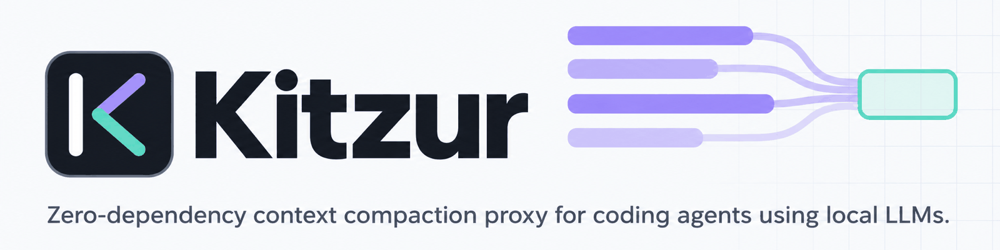
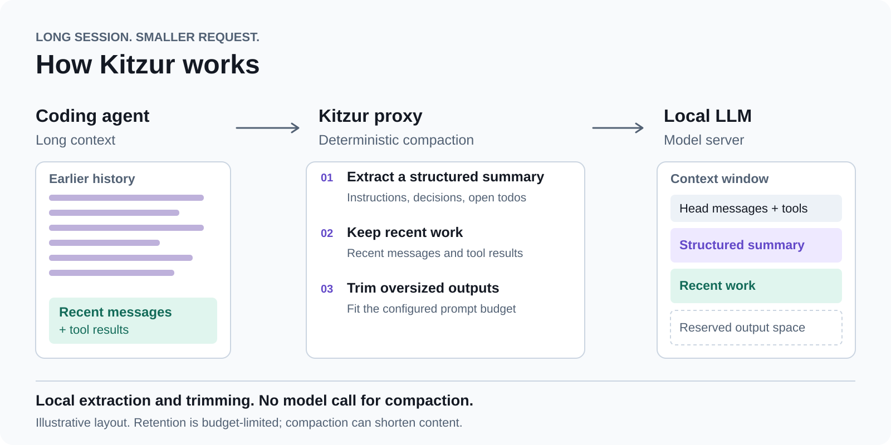

<div align="center">

<picture>
  <source media="(prefers-color-scheme: dark)" srcset="docs/assets/banner-dark.png">
  <source media="(prefers-color-scheme: light)" srcset="docs/assets/banner-light.png">
  
</picture>

### Keep coding in a smaller context window.

[](https://github.com/lemun/kitzur/actions/workflows/ci.yml)
[](package.json)
[](package.json)
[](LICENSE)

[Quick start](#quick-start) · [How it works](#how-it-works) · [Benchmarks](#benchmarks) · [Configuration](#configuration) · [FAQ](#faq-and-limits) · [Docs](#documentation)

</div>

Kitzur is a local proxy that sits between a coding agent and its model server. It
shrinks each request before it reaches your model: older history becomes a
structured, mechanical summary of instructions, decisions and open work, recent
messages stay intact, and oversized tool output is trimmed. **No second LLM is
called to do it.**

<p align="center">
  
  <br>
  <sub>A scripted session growing through Kitzur (stub upstream, not a model).
  <a href="docs/assets/compaction.mp4">Watch the MP4</a>.</sub>
</p>

## Why Kitzur

Long coding sessions accumulate file reads, browser snapshots and tool output.
Small local windows (32k to 128k tokens) fill up fast, and then the server rejects
the request or the agent loses the thread.

- **Fits the window you actually serve.** Presets for 32k, 64k, 100k and 128k windows.
- **Deterministic and local.** The same history and settings produce the same
  request; there is no summarizer model to run, pay for or wait on.
- **Zero runtime dependencies.** Plain Node.js 22+, one HTTP hop on loopback.
- **Keeps the working set.** Tool calls stay paired with their results, and recent
  work is retained verbatim.
- **Drop-in.** Change the agent's base URL; nothing else about the agent changes.
- **Observable.** Every response says what Kitzur did, and `/status` shows budgets,
  counters and recent activity.

## Quick start

Requires **Node.js 22+** and a running OpenAI-compatible Chat Completions server. The
served model's `tokenizer.json` is recommended for exact counts: without it
(`tokenizer.path: null`), `serve` still starts, logs a warning and counts with a
conservative per-class estimate. Kitzur is built from source:

```sh
git clone https://github.com/lemun/kitzur.git
cd kitzur
npm ci
npm run build
node dist/src/cli.js config init --preset 100k --out ~/.config/kitzur/kitzur.jsonc \
  --upstream http://127.0.0.1:8000 --tokenizer /path/to/tokenizer.json
```

`--upstream` is the server's `scheme://host[:port]` and `--tokenizer` the served model's
`tokenizer.json` (both can also be edited in the generated file later). Then start the proxy with that file.
Without `--config` (and without `KITZUR_CONFIG`), `serve` looks for `kitzur.jsonc` in
`$XDG_CONFIG_HOME/kitzur/` when that variable is set to an absolute path, else in `~/.config/kitzur/`;
the explicit form works everywhere:

```sh
node dist/src/cli.js serve --config ~/.config/kitzur/kitzur.jsonc
```

`serve` prints only `listening on …` (and fatal errors) to the terminal. Warnings, such as
a missing tokenizer or an unreachable upstream, go to the rotating log file
`~/.local/state/kitzur/logs/kitzur-YYYY-MM-DD.log` (UTC date; `$XDG_STATE_HOME/kitzur/logs/`
when set). Add `--foreground` to echo them to the terminal.

<p align="center">
  
  <br>
  <sub>Config, validate, serve, status. The upstream is a demo stub.
  <a href="docs/assets/quickstart.mp4">Watch the MP4</a>.</sub>
</p>

Kitzur listens on `http://127.0.0.1:8270` and appends the client's request path
unchanged. For an upstream API at `http://127.0.0.1:8000/v1`, point the agent at
**`http://127.0.0.1:8270/v1`**. Use the limits your server actually serves, and
configure the agent with the same ones.

The tokenizer is not bundled. `scripts/fetch-tokenizer.sh` (needs `curl`) downloads the
Qwen3.6-27B tokenizer for development and tests; use your own model's for real work.

To install a `kitzur` command instead of running from the checkout, pack the build and
install the archive globally (or build the offline bundle with `scripts/pack-offline.sh`,
see [deployment](deploy/README.md)):

```sh
npm pack                        # after npm run build; writes kitzur-<version>.tgz
npm install -g ./kitzur-*.tgz
kitzur version
```

### Point your agent at the proxy

An OpenCode provider (`opencode.json`):

```json
{
  "provider": {
    "kitzur": {
      "npm": "@ai-sdk/openai-compatible",
      "name": "Local model via kitzur",
      "options": {
        "baseURL": "http://127.0.0.1:8270/v1",
        "apiKey": "{env:GATEWAY_API_KEY}"
      },
      "models": {
        "local-model": {
          "name": "Local model",
          "tool_call": true,
          "limit": { "context": 100000, "output": 32000 }
        }
      }
    }
  },
  "model": "kitzur/local-model",
  "compaction": { "auto": true }
}
```

Replace `local-model` with the model ID your server exposes. OpenCode sends `apiKey` as
`Authorization: Bearer …`; without `listen.token`, Kitzur forwards that header to the
upstream unchanged and never logs it. Set `GATEWAY_API_KEY` to your gateway's key if it
needs one; if it needs none, any value works (OpenCode may require a non-empty key).
Keep the client's own compaction enabled as a fallback. Kilo uses a similar provider block in
`kilo.json[c]`; its `max_tokens` behavior may need `budget.maxTokensRestore.enabled: true`.
See [CONFIG.md](CONFIG.md).

If the gateway credentials live in kitzur's `upstream.headers`, set `listen.token`
too, so other local processes cannot use them through the proxy (see
[SECURITY.md](SECURITY.md)). `apiKey` then carries that token, not the gateway key:
`"apiKey": "{env:KITZUR_TOKEN}"`. `status` and `doctor` send the configured token.

## See compaction happen

Every chat response carries `x-kitzur-action` and `x-kitzur-tokens` (`in/out/trigger`),
and `kitzur status` summarizes the proxy from another terminal:

```sh
node dist/src/cli.js status          # readable summary and the five latest requests
node dist/src/cli.js status --json   # the full /status object
curl -s http://127.0.0.1:8270/status -H 'Authorization: Bearer <listen.token>'   # header only if listen.token is set
```

`status` finds the proxy through the same config as `serve` (`--config`, `KITZUR_CONFIG` or
the default `~/.config/kitzur/kitzur.jsonc`). If the proxy runs on another port or from a
config elsewhere, pass `-c FILE`. `--url http://127.0.0.1:PORT/status` skips the config, so it
sends no `listen.token`; use `-c FILE` when the listener requires a token, or `--url` gets a 401.

In the recording above, the agent sends a growing session against a 32k preset
(trigger 20,000 tokens). The first three requests pass through; the fourth is
compacted from 20,702 to 5,921 tokens, the next two reuse that forwarded prefix,
and the cycle repeats as the session grows. `in` is what the agent sent, `out` is
what Kitzur forwarded.

At the default `info` log level, each completed chat request also writes one line to
the rotating log file (`<stateDir>/logs/kitzur-YYYY-MM-DD.log` by default, or
`--log-file PATH`; `--foreground` echoes logs to a TTY):

```text
chat action=compact tokens=50000->20000 budget=60000 trigger=45000 target=30000 model="local-model" ms=125
```

The line contains sizes, budget thresholds, model and timing, never message content.
Actions are `passthrough`, `reuse`, `compact`, `clamp`, `truncate` or `refuse`.
Unknown counts (for example, an unparseable request forwarded unchanged) appear as
`unknown` in headers and logs. Shadow mode reports the actual passthrough rather than
the proposed compaction.

`/status` and `/kitzur/status` include `last_compaction: {at, in, out, trigger}`
(initially `null`) and `recent_requests`, the latest 64 completed chat requests in
completion order, each with `{action, tokens: {in, out, trigger}, model, ms}`. This
history is available even without a stats file and resets on restart.

## How it works

<p align="center">
  <picture>
    <source media="(prefers-color-scheme: dark)" srcset="docs/assets/how-it-works-dark.svg">
    
  </picture>
</p>

| During a long session | What Kitzur does |
|---|---|
| Earlier instructions get buried in tool output | Extracts instructions, decisions, todos, file paths and browser state into a structured summary. |
| The next step depends on recent tool results | Keeps recent tool calls paired with their results. |
| A snapshot or command output dominates the request | Trims oversized outputs to leave room for other context. |
| Requests repeat the same history | Preserves forwarded prefixes between compactions under the default policy. |
| The server counts tokens differently | Calibrates from usage and retries recognized overflows with smaller requests. |

Compaction runs locally and leaves transcript files unchanged. Each summary is
rebuilt from the original history the agent sends. Retention is bounded by the
available budget: under pressure, facts and user text can be shortened.
[How compaction works and where it can lose information](DESIGN.md).

## Benchmarks

Here is a **46-step simulated browser session** with a 100,000-token context window
and 32,000 tokens reserved for output. Both arms use the same scripted scenario; the
direct client has no compaction of its own.

| Point in the session | Without Kitzur: direct client | Through the Kitzur proxy |
|---|---:|---:|
| Start · step 1 | 9,376 prompt tokens | 9,376 prompt tokens |
| First overflow · step 11 | 74,445 · **rejected** | 28,251 · accepted |
| Halfway · step 23 | Stopped at step 11 | 30,196 · accepted |
| End · step 46 | Stopped at step 11 | 45,176 · accepted |

**46/46 steps completed through Kitzur · 7/7 planted facts retained · No client errors**

These are measured mock-server requests, not a live model solving a task. The
32,000-token output reservation leaves 68,000 tokens for the prompt at the server;
the direct request at step 11 exceeds that allowance. Kitzur compacts earlier.
[Inspect the recorded measurements](bench/examples/readme-qa46.json).

An agent with its own compaction can also finish. In the same scenario, Kitzur
processed **31.4% fewer prompt tokens** than the offline OpenCode compaction
simulation:

| System | Steps completed | Prompt tokens, all attempts | Planted facts retained |
|---|---:|---:|---:|
| Direct client, no compaction | 10/46 | 429,881¹ | Not comparable: stopped early |
| OpenCode compaction mechanics, offline simulation | 46/46 | 2,492,849 | Not evaluated |
| **Kitzur, default 100k preset** | **46/46** | **1,710,787** | **7/7** |

¹ The direct client's total covers only its partial session, including the rejected
request. The 31.4% comparison uses the two completed sessions.

Measured October 2, 2026, using `qa46-ref` and the Qwen3.6-27B tokenizer. Totals
include rejected attempts and simulated summary requests. OpenCode's simulation
uses scripted summaries, not an LLM. Fact retention checks marker presence, not
model comprehension. These measurements establish compaction behavior, not
inference speed, billing savings or real-model task quality.

[Reproduce this comparison](bench/README.md#readme-demonstration) ·
[Benchmark methodology and historical Gobstopper comparison](bench/README.md)

## Configuration

Settings merge in this order: built-in defaults, preset, config file, `KITZUR_*`
environment, command-line flags. A minimal `kitzur.jsonc` (JSON with comments):

```jsonc
{
  "preset": "100k",
  "upstream": { "origin": "http://127.0.0.1:8000" },
  "tokenizer": { "path": "/path/to/tokenizer.json" },
  "listen": { "host": "127.0.0.1", "port": 8270 }
}
```

Presets pair context and output limits: `32k`/8k, `64k`/16k, `100k`/32k and
`128k`/32k. Check a file with `kitzur config validate -c kitzur.jsonc` and see where
every effective value comes from with `kitzur config show -c kitzur.jsonc`. Every
knob, its default and what breaks when it is wrong is in [CONFIG.md](CONFIG.md).

### Commands

In a checkout, use `node dist/src/cli.js` in place of `kitzur`.

```text
kitzur serve                         run the proxy
kitzur status [--url URL] [--json]   inspect budgets, counters and recent activity
kitzur doctor [--json]               diagnose setup (--check-upstream for a small probe)
kitzur report stats.jsonl [--json]   summarize request reduction, retries and timing
kitzur config init|show|validate      create or inspect configuration
kitzur config import-eval DIR        import gateway probe results as configuration
kitzur replay FILE|DIR               replay captured request bodies locally
kitzur count request.json            count a request
kitzur state show|reset              inspect or clear learned limits
kitzur bench [--quick]               run benchmarks from a development checkout
kitzur version                       print the installed version
```

Status is available at `/status` and `/kitzur/status`. State defaults to
`~/.local/state/kitzur` (or `$XDG_STATE_HOME/kitzur`).

## FAQ and limits

**Which API and agents?** Kitzur supports OpenAI **Chat Completions**. Use an agent
that lets you configure an OpenAI-compatible base URL, such as OpenCode or Kilo
Code. This release does not support OpenAI Responses or Anthropic Messages.

**Which context sizes?** Presets cover 32k, 64k, 100k and 128k windows. Set the
proxy and agent to the limits your server actually serves. Counting uses a supported
tokenizer and matching chat-template profile; unsupported tokenizers can use
conservative estimates. See [tokenizer and budget configuration](CONFIG.md).

**Does it replace the agent's own compaction?** Keep native compaction enabled as
a fallback. Kitzur reduces outgoing requests; client limits and client compaction
can still apply.

**Does compaction call another model?** No. It uses deterministic extraction and
trimming. The configured upstream still receives the forwarded request. Optional
plan persistence stores user content locally; see [security and privacy](SECURITY.md).

**Can it lose information?** Yes. Summaries are mechanical and bounded by the
budget; under pressure, facts and user text can be shortened. The benchmarks above
use a synthetic scripted session and check marker retention, not comprehension or
real-model task quality. Real-model validation is still pending
([coding task evaluation](bench/coding/README.md)).

## Running in the background

<details>
<summary>Windows, macOS and Linux service setup</summary>

Serving logs go to `<stateDir>/logs/kitzur-YYYY-MM-DD.log` by default, with seven
UTC dates retained and a 10 MiB size cap plus one backup. Use `--log-file PATH`
for a fixed location. `--foreground` opts into console echo when stderr is a TTY;
slow console output is dropped instead of delaying requests.

On **Windows**, run Node detached from PowerShell (replace the two paths):

```powershell
Start-Process -FilePath 'node' -ArgumentList '"C:\path\to\kitzur\dist\src\cli.js" serve --config "C:\path\to\kitzur.json"' -WindowStyle Hidden -RedirectStandardOutput "$env:TEMP\kitzur-out.log" -RedirectStandardError "$env:TEMP\kitzur-err.log"
```

Alternatively, create a Task Scheduler task that runs `node` with the same script,
`serve`, and `--config` arguments, using “Run whether user is logged on or not.”
The server still writes its rotating file log. Paused console selection (QuickEdit)
can freeze older versions that write synchronously to the console. `kitzur doctor`
checks the configured local listener and reports a process that accepts TCP but
cannot answer `/status` within three seconds.

On **macOS**, start from the LaunchAgent template
[deploy/com.github.lemun.kitzur.plist](deploy/com.github.lemun.kitzur.plist): replace
`__HOME__` with your home directory and the `dist/src/cli.js` path with your checkout's,
copy it to `~/Library/LaunchAgents/`, and load it with
`launchctl bootstrap gui/$(id -u) ~/Library/LaunchAgents/com.github.lemun.kitzur.plist`
([details](deploy/README.md#macos-launchd)). The rotating server log remains in the
configured state directory.

On **Linux**, create `~/.config/systemd/user/kitzur.service`:

```ini
[Unit]
Description=Kitzur context compaction proxy

[Service]
Environment=KITZUR_CONFIG=%h/.config/kitzur/kitzur.jsonc
ExecStart=/absolute/path/to/node /absolute/path/to/kitzur/dist/src/cli.js serve
Restart=on-failure
StandardOutput=append:%h/.local/state/kitzur/service-out.log
StandardError=append:%h/.local/state/kitzur/service-err.log

[Install]
WantedBy=default.target
```

The config path is set with `KITZUR_CONFIG`, as in the shipped
[deploy/kitzur.service](deploy/kitzur.service) and the launchd template, so all three read it
the same way and `ExecStart` only changes for the `node` path. The two output files get only
the startup line and fatal errors. Create `~/.local/state/kitzur` first, then run `systemctl --user daemon-reload`
and `systemctl --user enable --now kitzur`. See [CONFIG.md](CONFIG.md) for logging
settings and `/status` health counters.

For a packaged installation or a persistent user service, see [deployment](deploy/README.md)
and the Windows [user guide](deploy/windows/USER.md) and [administrator guide](deploy/windows/ADMIN.md).

</details>

`kitzur status` shows a readable summary and the five latest requests; use
`kitzur status --json` for the complete raw object. `/status` and `/kitzur/status`
include `last_compaction: {at, in, out, trigger}` (initially `null`) and
`recent_requests`, the latest 64 completed chat requests in completion order, each
with `{action, tokens: {in, out, trigger}, model, ms}`. Unknown counts are `null`.
This history is available even without a stats file and resets on restart.

When the client sets an input limit (for example OpenCode `limit.input`), set
`client.inputLimit` to match. Kitzur derives the client compaction point as
`max(0, inputLimit − (reservedTokens ?? min(20000, capped output limit)))`.
Use `client.reservedTokens` for an explicit reservation, including zero;
`client.compactionPointTokens` overrides this calculation. For a 100000 context,
66000 input and 32000 output, the client point is 46000 and Kitzur triggers below
it. Without an input limit, existing context-minus-output behavior is preserved.
See [CONFIG.md](CONFIG.md) for all budget settings.
## Documentation

| Document | What it covers |
|---|---|
| [Upstream rotation](docs/UPSTREAM-ROTATION.md) | External key routing: authorized pooling only; no increase to shared limits or evasion of per-user limits/terms |
| [CONFIG.md](CONFIG.md) | Every configuration knob, presets, environment, client setup |
| [DESIGN.md](DESIGN.md) | Architecture, planning, prefix stability and known limits |
| [SECURITY.md](SECURITY.md) | Threat model, privacy and vulnerability reporting |
| [docs/DIAGNOSTICS.md](docs/DIAGNOSTICS.md) | Setup diagnostics and session reports |
| [bench/README.md](bench/README.md) | Benchmark methodology and reproduction |
| [deploy/README.md](deploy/README.md) | Packaging, the systemd user service and the macOS launchd agent |
| [CHANGELOG.md](CHANGELOG.md) | Notable changes per release |

## Contributing

```sh
npm ci
scripts/fetch-tokenizer.sh
npm test
```

`scripts/fetch-tokenizer.sh` needs `curl`. Tests that require the development tokenizer
skip when it is absent. CI downloads it and runs the full suite on Linux Node 22, 24 and 26 (with and without the tokenizer),
plus portable suites and packaged CLI/installation lifecycle checks on Windows Node 22, 24 and 26.
Gobstopper comparisons require a separately built gobstopper; an external Python
reference harness and virtual environment are optional and used only for the parity
cross-check.

Bug reports and pull requests are welcome: see [CONTRIBUTING.md](CONTRIBUTING.md).
Use synthetic examples and remove credentials, prompts and private URLs from reports.

## License

[MIT](LICENSE). Kitzur is Hebrew for “shortcut”. Portions derive from gobstopper and
other upstream projects; [THIRD_PARTY_NOTICES.md](THIRD_PARTY_NOTICES.md) and
[LICENSES/](LICENSES/) preserve their notices.

The recordings above were made with [vhs](https://github.com/charmbracelet/vhs) against
a stub upstream; `docs/assets/demo/record.sh` regenerates them.
